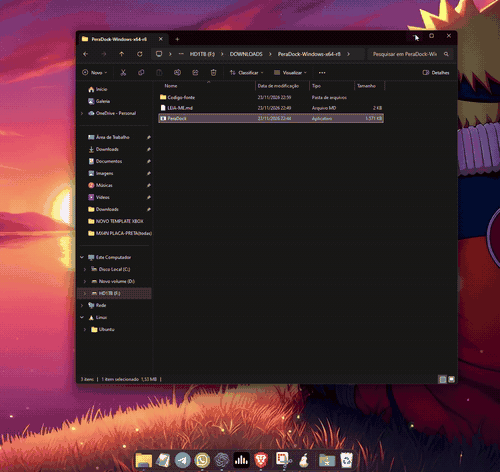
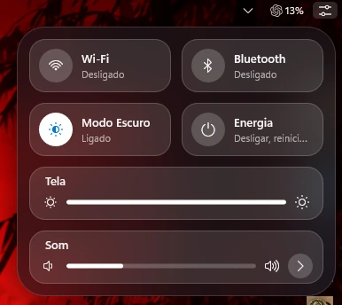
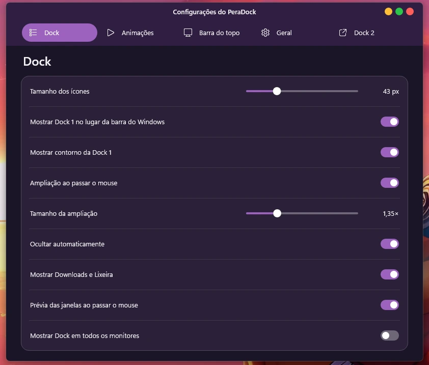
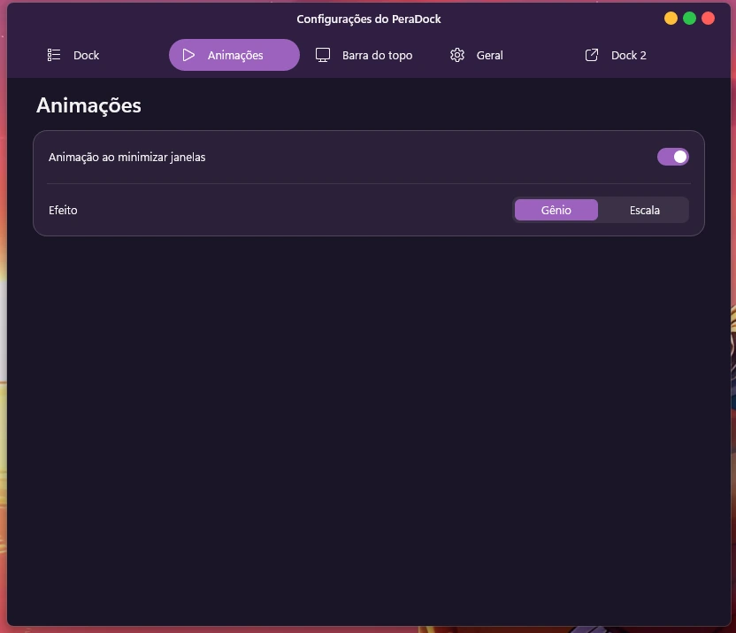
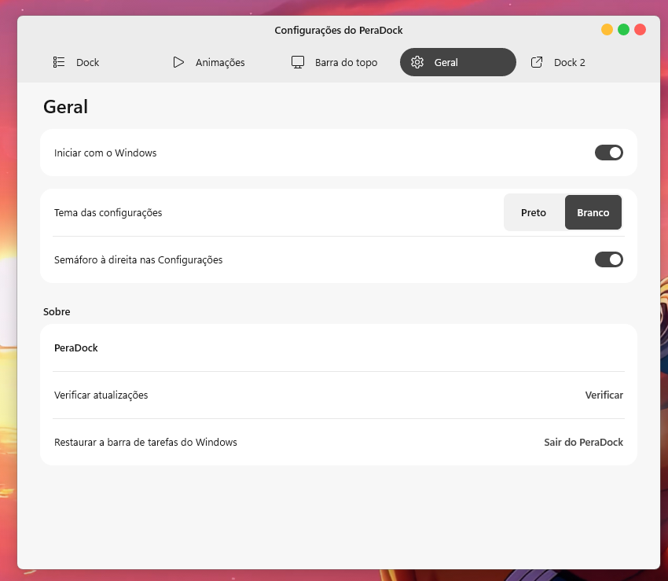

# PeraDock

Dock para Windows x64 com launcher e barra lateral opcional.

[Baixar PeraDock](https://github.com/PeraTV/PeraDock/raw/refs/heads/main/downloads/PeraDock-Windows-x64-r8.zip) · [Lançamentos](https://github.com/PeraTV/PeraDock/releases)

Extraia o ZIP, feche a versão anterior e abra `PeraDock.exe`. O ZIP inclui o código-fonte e as instruções de compilação.

- **Configurações → Geral → Verificar atualizações** consulta a versão mais recente.
- **Configurações → Dock** permite ocultar a Dock 1, devolver a barra de tarefas ao Windows e ajustar o contorno.
- **Dock 2** permite adicionar separadores pelo menu de contexto de um aplicativo.

## PeraDock em ação

### Efeito Gênio ao minimizar

### Launcher e painéis

| Central de Controle | Desempenho |
| --- | --- |
|  |  |

Ver as telas de configurações

| Dock 1 | Dock 2 |
| --- | --- |
|  |  |

| Animações | Barra do topo |
| --- | --- |
|  |  |

