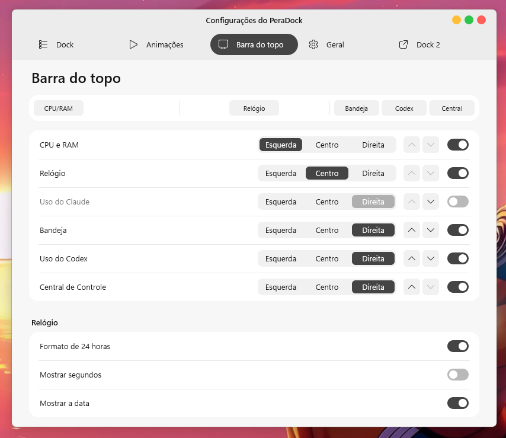
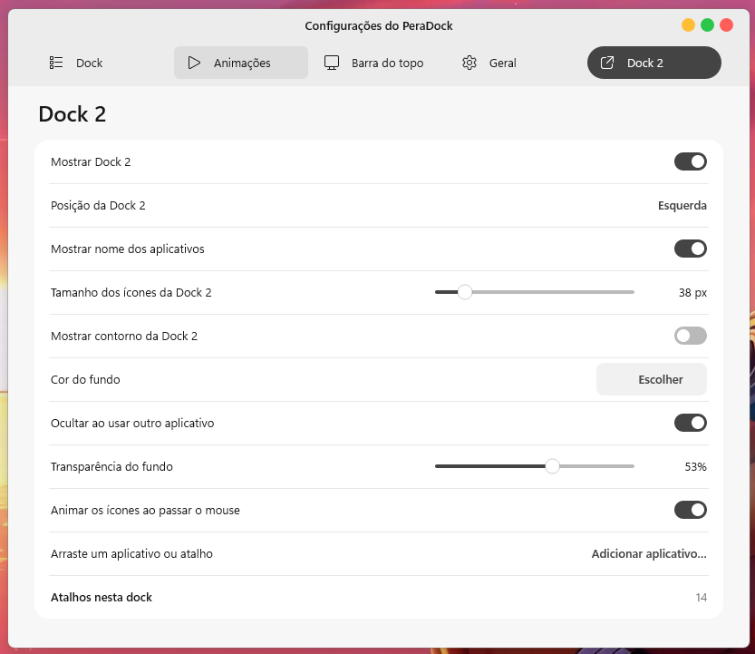
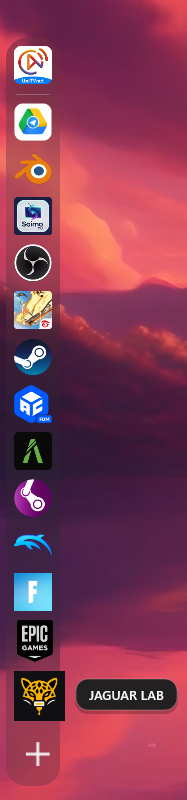
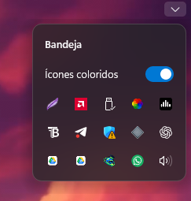
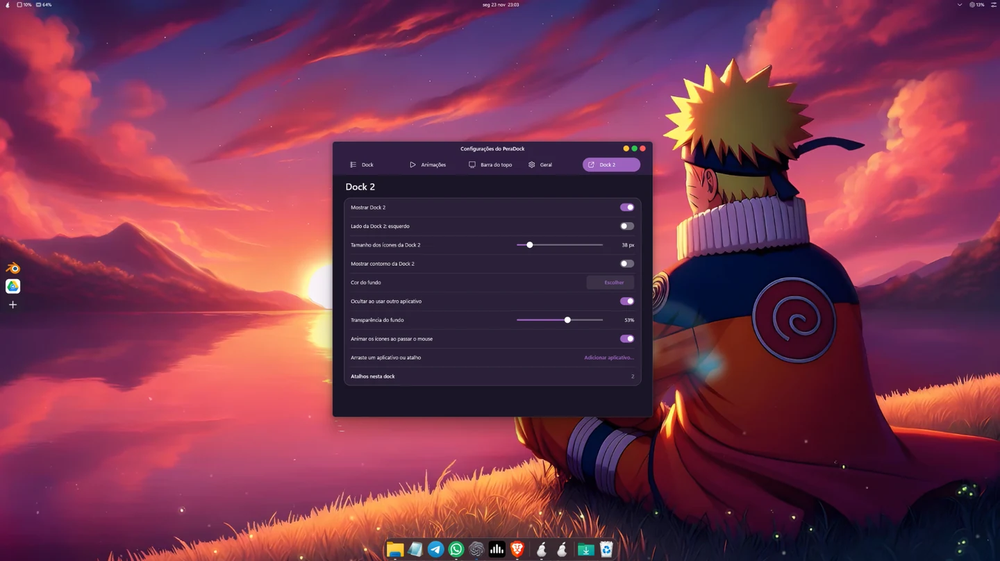
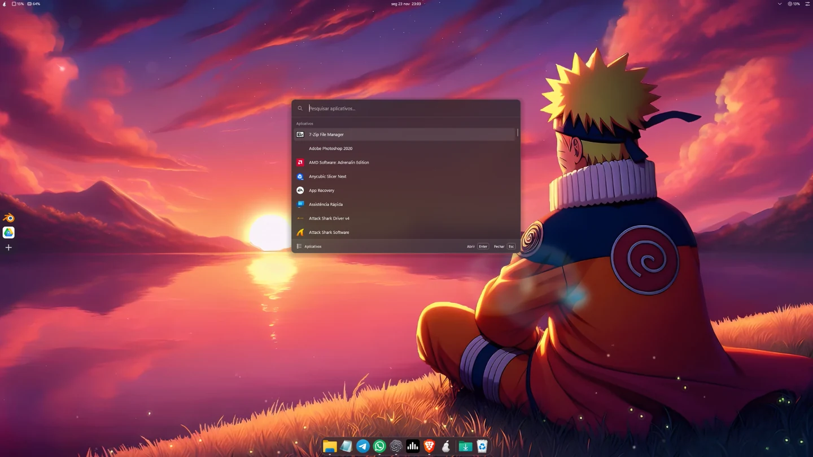
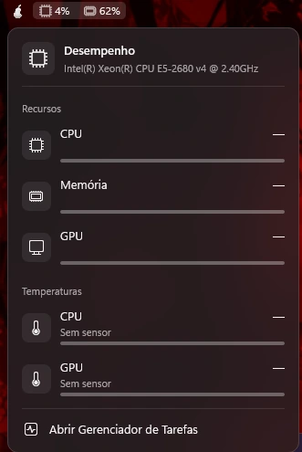

# PeraDock

Dock para Windows x64 com launcher e barra lateral opcional.

[Baixar PeraDock](https://github.com/PeraTV/PeraDock/raw/refs/heads/main/downloads/PeraDock.zip) · [Lançamentos](https://github.com/PeraTV/PeraDock/releases)

Extraia o ZIP, feche a versão anterior e abra `PeraDock.exe`. O ZIP inclui o código-fonte e as instruções de compilação.

O PeraDock é um projeto independente e o executável não tem assinatura digital. O Windows pode exibir um aviso do SmartScreen ao abrir. Esse alerta, por si só, não indica que o arquivo seja malicioso.

- **Configurações → Geral → Verificar atualizações** consulta a versão mais recente.
- **Configurações → Dock** permite ocultar a Dock 1, devolver a barra de tarefas ao Windows e ajustar o contorno.
- **Dock 2** permite adicionar separadores pelo menu de contexto de um aplicativo.
- As duas docks podem ser posicionadas em qualquer uma das quatro bordas da tela. Segure o botão do meio do mouse e arraste a dock até a borda desejada.
- Arraste os atalhos para reorganizá-los. Os ícones vizinhos deslizam para abrir espaço durante o arrasto.
- Os nomes dos apps ficam desativados por padrão. Na Dock 2, ative **Mostrar nome dos aplicativos** para vê-los em um cartão arredondado ao passar o mouse.
- Em **Configurações → Geral → Tema das configurações**, escolha **Preto** ou **Branco**.

## PeraDock em ação

### Configurações na R10

| Tema Preto | Tema Branco |
| --- | --- |
|  |  |

Ver as abas Animações, Barra do topo e Dock 2

| Animações | Barra do topo |
| --- | --- |
|  |  |

### Dock 2 e Bandeja

| Nome do aplicativo na Dock 2 | Bandeja da barra do topo |
| --- | --- |
|  |  |

### Área de trabalho

### Efeito Gênio ao minimizar

### Launcher e painéis

| Central de Controle | Desempenho |
| --- | --- |
|  |  |
